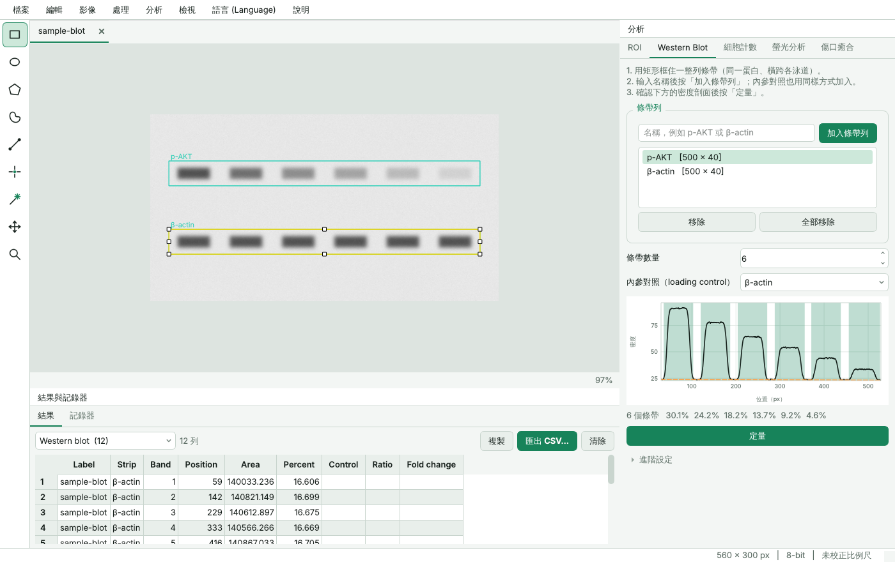

# ORIS — Open Research Image Studio

多國語言的生命科學影像分析軟體｜A multilingual image-analysis application for the life sciences

**版本 1.0.0** · Mac / Windows / Linux · 介面語言：繁體中文、English、日本語、한국어、Español、Français、Deutsch

## ⬇️ 下載 Download

到 **[Releases 下載頁](../../releases/latest)** 依電腦選擇：

| 電腦 | 下載這個檔案 | 安裝方式 |
|---|---|---|
| Mac（M1／M2／M3／M4 晶片） | `ORIS-…-Mac-AppleSilicon.dmg` | 打開 dmg，把 ORIS 拖進「應用程式」 |
| Mac（Intel 晶片） | `ORIS-…-Mac-Intel.dmg` | 同上 |
| Windows 10／11 | `ORIS-…-Windows-Setup.exe` | 按兩下安裝；或用 `…-Portable.zip` 免安裝版 |
| Linux | `ORIS-…-Linux.tar.gz` | 解壓縮後執行 `ORIS/ORIS` |

不確定 Mac 是哪種晶片：點左上角  ▸「關於這台 Mac」，「晶片」寫 Apple M 開頭就選 AppleSilicon，寫 Intel 就選 Intel。

**第一次開啟會出現安全提示（正常現象，只需一次）**
- **Mac**：若顯示「無法打開，因為無法驗證開發者」，到「系統設定 ▸ 隱私權與安全性」，捲到最下方按 **「強制打開」**（Open Anyway），再輸入密碼確認。
- **Windows**：若顯示「Windows 已保護您的電腦」，按 **「其他資訊」▸「仍要執行」**。

這是因為軟體尚未向 Apple／Microsoft 申請付費的開發者簽章，不影響功能與安全。



[English summary ↓](#english)

---

## 這是什麼

ORIS 把研究室最常用的 ImageJ 工作流程重新做成一套介面一致、可即時切換語言的軟體：

| 類別 | 功能 |
|---|---|
| 檔案 | TIFF（8／16／32 位元、多通道、堆疊、比例尺中繼資料）、PNG、JPEG、BMP、GIF、WebP；影像序列匯入為堆疊；拖放開啟 |
| 檢視 | 滾輪縮放、平移、多通道合成顯示、10 種色彩對應表（LUT）、亮度／對比（不改動像素）、深色／淺色主題 |
| 選取（ROI） | 矩形、橢圓、多邊形、手繪、直線、標記點、魔術棒；可移動、拉控制點調整；ROI 管理員（儲存／載入／全部測量） |
| 測量 | Area、Mean、StdDev、Min、Max、Median、IntDen、RawIntDen、質心、Perim.、Circ.、AR、Round、Solidity、Feret、MinFeret、%Area；直線長度與角度；直方圖；強度剖面圖；比例尺校正 |
| 處理 | 高斯、中值、平均、最小／最大、變異數、非銳化遮罩、帶通、扣除背景（rolling ball）、增強對比、直方圖等化、CLAHE、數學運算、影像計算機 |
| 二值影像 | 7 種自動閾值（Otsu、Li、Triangle、Yen、IsoData、Mean、Minimum）＋手動；侵蝕、膨脹、開／閉運算、填補孔洞、輪廓、骨架化、分水嶺、距離圖；顆粒分析 |
| 影像操作 | 型別轉換、裁切、複製、翻轉、旋轉、縮放、分離／合併通道、Z 投影、堆疊與影像互轉、比例尺圖示、含標註畫面匯出 |
| **Western blot** | 框選條帶列 → 自動偵測條帶、扣除背景、積分 → 以內參對照標準化並計算 fold change |
| **細胞計數** | 自動（閾值＋分水嶺分開相連細胞＋大小／圓度篩選）與手動（8 種類別標記） |
| **螢光／共定位** | CTCF；Pearson、Spearman、Manders M1／M2、MOC、ICQ、Costes 自動閾值、散佈圖 |
| **傷口癒合** | 依紋理自動偵測無細胞區域；面積、佔比、平均寬度；堆疊影像自動計算隨時間的癒合率 |
| 自動化 | 所有操作自動記錄成腳本（Python）；腳本編輯器；整個資料夾批次處理；結果匯出 CSV（Excel 可直接開啟中文） |
| 復原 | Ctrl+Z／Ctrl+Shift+Z（12 步） |

## 與 ImageJ 的關係（請先閱讀）

ORIS 是獨立撰寫的軟體，沒有使用 ImageJ 的程式碼。它涵蓋的是「日常最常用的核心功能」，**不是 ImageJ／Fiji 的完整替代品**。目前**沒有**的部分：

- 顯微鏡廠商專有格式（CZI、LIF、ND2、OIB/OIF、VSI…）——請先由顯微鏡軟體匯出 TIFF，或用 Fiji 的 Bio-Formats 轉檔
- ImageJ 外掛生態系與 `.ijm` 巨集（ORIS 的腳本是 Python，指令名稱不同）
- 3D／4D 視覺化與體積分析、追蹤（tracking）、影像拼接、反卷積、機器學習分割
- 超過記憶體容量的超大影像（虛擬堆疊）
- ImageJ `.roi`／`.zip` 選取範圍檔（ORIS 使用自己的 JSON 格式）

數值上，面積、強度、IntDen 等定義與 ImageJ 相同；周長、圓度、Feret 等形狀參數因演算法實作不同，數值會有差異（我沒有實際與 ImageJ 逐項比對過差異幅度）。**正式發表前，建議用您自己的代表性影像與既有流程交叉比對一次。**

## 從原始碼執行（開發者）

一般使用者請直接到上方下載頁。若要修改程式：

```bash
pip install -r requirements.txt
python run.py                # 啟動
python run.py --selftest     # 以範例影像核對四個分析模組的已知答案
python -m pytest             # 執行全部測試
```

每次推送到 main，`.github/workflows/build.yml` 會自動在 Mac、Windows、Linux 上測試、打包，並更新下載頁。要發布新版本，請同步提高 `oris/__init__.py`、`oris.spec` 與 workflow 中的 `ORIS_VERSION`。

## 五分鐘上手

啟動後按歡迎畫面的範例影像按鈕，或 **檔案 ▸ 開啟範例影像**。

**Western blot**　用矩形框住一整列條帶 → 輸入名稱（如 p-AKT）→「加入條帶列」；對內參（如 β-actin）重複一次 → 選擇「內參對照」→「定量」。下方表格會列出每個條帶的面積、Ratio 與 Fold change。右側剖面圖中綠色區域是被積分的範圍、橘色虛線是背景基線，請務必目視確認。

**細胞計數**　開啟影像 →「細胞計數」分頁 →「計數細胞」。相連的細胞沒有分開時調低「分割容許值」；被過度分割時調高。雜訊可用「最小尺寸」排除。

**螢光強度／共定位**　圈選細胞並加入 ROI 管理員（Ctrl+T）；背景區域的 ROI 命名為 `bg` →「測量強度」得到 CTCF。共定位：選兩個通道 →「分析共定位」。

**傷口癒合**　**檔案 ▸ 匯入影像序列** 一次選取各時間點影像 →「測量傷口」。偵測範圍偏大／偏小時調整「靈敏度」。

**比例尺**　沿影像中的比例尺畫一條直線 → **影像 ▸ 設定比例尺** → 輸入實際長度與單位。

快捷鍵：工具 `R` `O` `G` `F` `L` `P` `W` `H` `Z`；測量 `Ctrl+M`；加入 ROI `Ctrl+T`；直方圖 `Ctrl+H`；剖面 `Ctrl+K`；閾值 `Ctrl+Shift+T`；亮度對比 `Ctrl+Shift+C`；上／下一張切片 `,` `.`。

## 多國語言

- 切換：選單列的 **語言 (Language)**，或歡迎畫面下方的下拉選單。立即生效，不需重新啟動；下次啟動會記住。
- 首次啟動會依作業系統語言自動選擇。
- **新增語言不需要改程式**：複製 `oris/locales/en.json`，改名為語言代碼（例如 `vi.json`、`th.json`），把 `_name` 改成該語言的名稱並翻譯各項文字，重新啟動後就會出現在選單中。也可以放在使用者資料夾 `~/.oris/locales/`。
- 漏翻的項目會自動顯示英文。執行 `python tests/check_locales.py` 可檢查每個語言檔是否完整、`{佔位符}` 是否一致。
- 測量結果的欄位名稱（Area、Mean、IntDen…）刻意維持與 ImageJ 相同的英文，方便沿用既有的試算表、統計腳本與論文寫法。

> 繁體中文與英文以外的五種語言由我翻譯，尚未經母語使用者校對；專業術語若與當地慣用說法不同，直接修改對應的 JSON 檔即可。

## 腳本與批次處理

您在介面上做的每一步都會出現在下方「記錄器」分頁，例如：

```python
run("subtract_background", radius=50.0, light_background=False)
run("count_cells", sigma=1.5, split=True, min_size=20.0, exclude_edges=True)
```

把它貼到 **分析 ▸ 批次處理資料夾**，選擇輸入資料夾後執行，所有影像的結果會彙整在同一個表格。完整指令清單見 [docs/SCRIPTING.md](docs/SCRIPTING.md)。

## 驗證方式

`tests/` 內含自動化測試（`python -m pytest`），以**已知答案的合成影像**檢查數值：

| 項目 | 檢查內容 | 結果 |
|---|---|---|
| Western blot | 6 條帶已知相對量 1.0／0.8／0.6／0.45／0.3／0.15，經內參標準化後的 fold change | 誤差 ≤ 0.02；亮底暗帶與暗底亮帶結果一致 |
| 細胞計數 | 60 顆細胞核，其中 10 對相連 | 60／60（不啟用分水嶺時為 50） |
| 傷口癒合 | 三個時間點、間隙佔影像 34.4%／21.9%／9.4% | 誤差 < 1 個百分點 |
| 共定位 | 同一影像自我比較、隨機雜訊、完全互斥 | r = 1／≈ 0／−1，Manders 相應為 1／≈ 0／0 |
| 測量 | 矩形、橢圓、直線的面積、周長、Feret、質心（含比例尺換算） | 與解析解一致 |
| 檔案 | 8／16 位元、多通道、堆疊、RGB 的 TIFF／PNG 讀寫 | 像素與比例尺完全還原 |
| 穩定性 | 全部 74 個操作 × 8 種特殊影像（全黑、1×1、單列、RGB 堆疊…）× 3 種選取狀態 | 無當機，僅回報可翻譯的提示訊息 |
| 介面 | `tests/ui_smoke.py` 以模擬滑鼠操作走過所有模組、對話框與七種語言 | 通過 |

這些是合成影像上的正確性檢查，能確認演算法與計算無誤，但**不能取代用真實實驗影像的驗證**：真實影像有不均勻背景、過曝、雜訊與各種染色差異，請以自己的資料確認參數是否合適。

## 已知限制

- 大影像（約 1,200 萬像素）上，顆粒分析約 4 秒、含分水嶺的細胞計數約 6 秒、中值濾鏡約 2 秒；比 ImageJ 慢。
- 「扣除背景」為 rolling ball 的近似實作，結果與 ImageJ 接近但不完全相同。
- 傷口偵測以紋理為依據；若傷口已完全癒合、或背景本身有明顯紋理／刮痕，自動閾值可能誤判，請調整靈敏度或改用手動圈選。
- 共定位係數對背景非常敏感，分析前請先扣除背景，並以選取範圍限定在細胞區域內。
- Western blot 定量假設條帶未過曝；飽和的條帶無法由任何軟體正確定量。
- 復原不包含分析標註（輪廓、編號）的逐步還原。

## 專案結構

```
run.py          啟動程式
assets/         App 圖示　　packaging/  Windows 安裝程式設定　　oris.spec  打包設定
oris/core/      分析核心（不依賴介面，可單獨當 Python 函式庫使用）
  engine.py     操作登錄表：選單、對話框、記錄器、腳本、批次共用同一份實作
  analysis.py   Western blot、細胞計數、共定位、螢光、傷口癒合
  measure.py    測量與顆粒分析　　filters.py  濾鏡、二值運算、閾值
  io.py         檔案讀寫　　　　　samples.py  範例影像
oris/ui/        介面（PySide6／Qt）
oris/locales/   語言檔（每種語言一個 JSON）
tests/          數值測試、介面走查、語言檔檢查
docs/           腳本指令參考、截圖
```

## 授權相關事實

ORIS 本身的授權由您決定（專案內未附授權條款）。它使用的程式庫：NumPy、SciPy、scikit-image、tifffile（BSD 類授權）、Pillow（MIT-CMU）、PySide6／Qt（LGPL v3）。若要對外散布打包後的執行檔，LGPL 對 Qt 有若干要求（例如保留授權聲明、允許使用者替換 Qt 程式庫）；正式商業散布前建議請熟悉軟體授權的專業人士確認，以上並非法律意見。

---

<a name="english"></a>

## English

ORIS is a desktop application that re-implements the most-used ImageJ workflows behind one consistent interface that can switch language instantly (Traditional Chinese, English, Japanese, Korean, Spanish, French, German).

**What it covers** — TIFF/PNG/JPEG I/O including 16/32-bit, multichannel and stack TIFFs with calibration; zoom/pan, LUTs, non-destructive brightness/contrast; rectangle, ellipse, polygon, freehand, line, multi-point and wand selections with an ROI manager; the standard ImageJ measurement set; histogram and profile plots; a full set of filters, math and binary operations, seven auto-threshold methods and particle analysis; guided modules for **Western blot quantification**, **cell counting**, **fluorescence intensity (CTCF) and colocalization**, and **wound-healing assays**; undo; a macro recorder, Python script editor and folder batch processing; CSV export.

**What it does not cover** — It is independent software, not a complete replacement for ImageJ/Fiji. There is no support for proprietary microscope formats (CZI, LIF, ND2 … export to TIFF first), ImageJ plugins or `.ijm` macros, 3D/4D visualisation, tracking, stitching, deconvolution, virtual stacks, or ImageJ `.roi` files. Area and intensity measurements follow the ImageJ definitions exactly; shape descriptors (perimeter, circularity, Feret) will differ somewhat because the algorithms differ (the size of the difference has not been measured against ImageJ). Cross-check against your existing pipeline on representative images before relying on it for publication.

**Download** — installers for Mac (Apple Silicon and Intel), Windows and Linux are on the [Releases page](../../releases/latest); no Python needed. The apps are not yet code-signed, so macOS asks once for *System Settings ▸ Privacy & Security ▸ Open Anyway* and Windows SmartScreen for *More info ▸ Run anyway*. Developers: `pip install -r requirements.txt && python run.py`; every push to main rebuilds and republishes the installers.

**Languages** — switch from the *Language* menu or the selector on the welcome screen. To add a language, copy `oris/locales/en.json` to `<code>.json`, translate the values and restart; missing entries fall back to English. `python tests/check_locales.py` checks completeness. The Japanese, Korean, Spanish, French and German files were machine-authored and have not been reviewed by native speakers.

**Scripting** — every action is recorded as a Python line such as `run("gaussian", sigma=2.0)`; see [docs/SCRIPTING.md](docs/SCRIPTING.md).

**Validation** — `python -m pytest` checks the numbers against synthetic images with known ground truth (band ratios within 0.02, 60/60 nuclei with touching pairs, wound area within one percentage point, colocalization limiting cases, analytic shapes, lossless file round-trips) and runs all 74 operations against eight kinds of awkward input. `tests/ui_smoke.py` drives the interface end to end in all seven languages. Synthetic tests confirm the computations are correct; they do not replace validation on your own experimental images.
